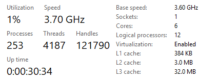
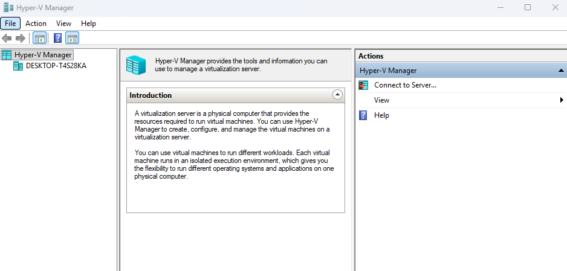

# Phase 0: Prepare the PC and the project

Learning notes for this phase, written the same day you do the work:

* what you set out to do and what you actually did
* commands you ran, and what each part of the command does
* screenshots of results, saved in `screenshots/`
* test results: what you expected and what happened
* problems you hit and how you solved them, with the ServiceNow incident or change number

End the phase with a short summary of what you learned and what you would do differently.

## 2026-10-12 – Enabled virtualization

* Task Manager > Performance > CPU showed "Virtualization: Disabled"
(but "Hyper-V support: Yes", meaning the CPU supports it).
* Fixed it: BIOS > SVM Mode > Enabled. On AMD it's called SVM, not VT-x.
* Checked again: Task Manager now shows "Virtualization: Enabled".

## 2026-10-14 – Turned on Hyper-V
* Confirmed Windows 11 Pro (Settings > System > About), which supports Hyper-V.
* Turned on Hyper-V in "Turn Windows features on or off" (Management Tools + Platform), then rebooted.
* Checked: Hyper-V Manager opens and shows my PC. Task Manager now says "A hypervisor has been detected."

## Downloaded and checked ISOs
Stored in E:\HomeLab\ISOs (not in Git, too big).

| File | Version | SHA-256 (first 12 chars) | Matches vendor? |
|---|---|---|---|
| WinServer2025-eval.iso | build 26100 | 7B052573BA78 | no published hash |
| Win11-Enterprise-eval.iso | 26H2, build 26300 | BC3F24086EBA | no published hash |
| ubuntu-26.04.1-live-server-amd64.iso | 26.04.1 | CC8A95CDE20F | yes |
| kali-linux-2026.2-hyperv-amd64.7z | 2026.2 | D7CD667761B1 | yes |

* Checked with PowerShell: Get-FileHash * | Format-List
* Used Ubuntu 26.04 instead of 24.04 because it's the newest LTS.
* Used Kali's pre-built Hyper-V image instead of the installer ISO, so there's no OS install needed.

* Created ServiceNow CMDB record HOST01 (Computer) for the physical host.
* Jira space "Enterprise Network Lab": 10 Epics (KAN-4 to KAN-13), one per phase. Phase 0 Tasks under KAN-4.

* Planned the schedule on 2026-10-14, using 2026-10-12 as the start. New finish date: 2026-12-20. Baseline saved in tracking/schedule.pod.
