# Phase 1: Multi-subnet network, RRAS routing and Windows Firewall

Learning notes for this phase, written the same day you do the work:

- what you set out to do and what you actually did
- commands you ran, and what each part of the command does
- screenshots of results, saved in `screenshots/`
- test results: what you expected and what happened
- problems you hit and how you solved them, with the ServiceNow incident or change number

End the phase with a short summary of what you learned and what you would do differently.

## 2026-10-18 – Planning
* Created the IPAM sheet (ipam/lab-ipam.xlsx) and the traffic policy (docs/traffic-policy.md).
* Raised change CHG0030001 "Build core network", planned Oct 19-23.

* CHG0030001 approved by Network group and CAB (on their behalf), moved to Implement.

## 2026-10-19 LAB-CORE virtual private switch created on Hyper-V
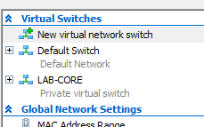

## CORE-RTR01 Created on Hyper-V
* Generation 2, 2048 MB Dynamic Memory, Default Switch, 2 virual processors, Network Adapters for LAB-CORE switch with VLAN IDs 10, 20, 30 and 40.
* Installed from bootable image file.

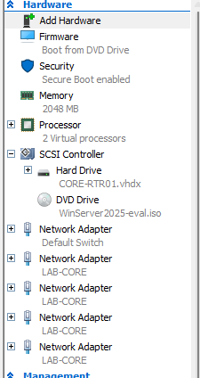

* VM login: use Ctrl+Alt+End (not Ctrl+Alt+Del) inside a Hyper-V window.

## CORE-RTR01 adapters
Matched Hyper-V adapters to Windows adapters by MAC address, then renamed them.

| MAC | VLAN | Windows name | IP |
|---|---|---|---|
| 00155D880100 | Default Switch | OUTSIDE | DHCP |
| 00155D880101 | 10 | VLAN10-Servers | 10.10.10.1/24 |
| 00155D880102 | 20 | VLAN20-Workstations | 10.10.20.1/24 |
| 00155D880103 | 30 | VLAN30-Management | 10.10.30.1/24 |
| 00155D880104 | 40 | VLAN40-Guest | 10.10.40.1/24 |

* No default gateway on the VLAN adapters: the router is the gateway for those networks.

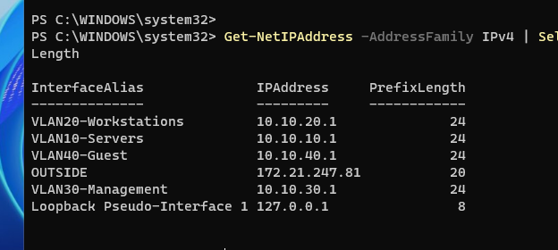

## 2026-10-25 Turned on Routing and NAT (RRAS)
* Installed routing role 
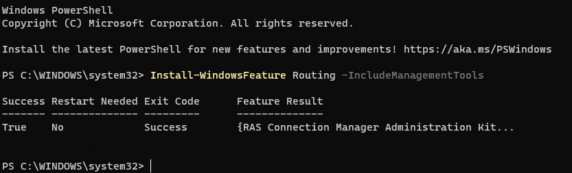

* Installed RRAS, custom config: LAN routing + NAT. NAT enabled on OUTSIDE (public interface)
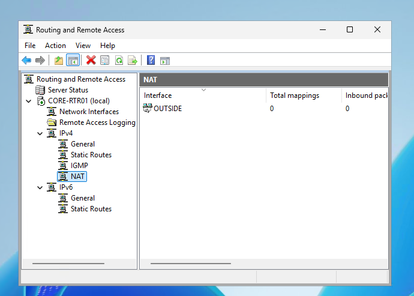

* Routing table: 4 connected routes (10.10.10/20/30/40.0/24, next hop 0.0.0.0) + default route 0.0.0.0/0 via OUTSIDE.
* Why the router knows these networks without typed routes: giving an adapter an IP + mask creates a "connected route" automatically. Static routes are only needed for networks the router isn't directly attached to.
* Forwarding is Enabled on all adapters (RRAS turned this on).
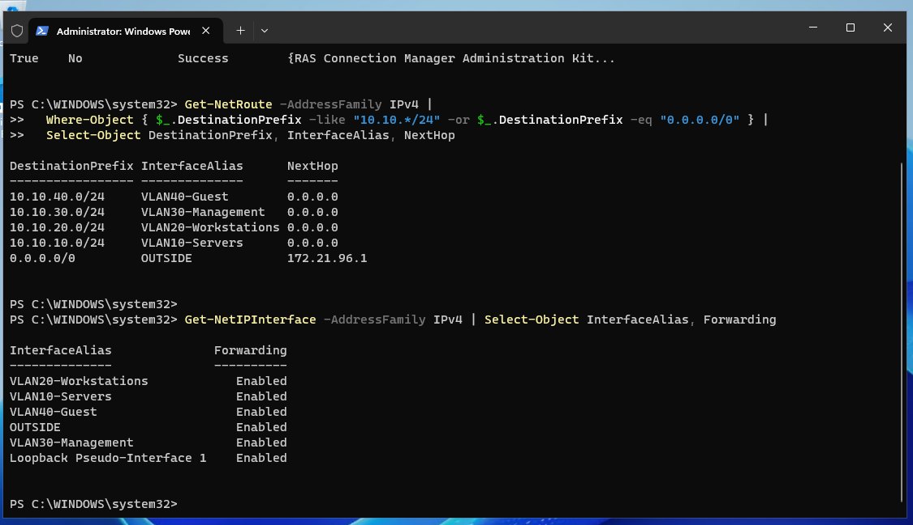

## 2026-10-28 – Built GUEST01 and tested routing
* Built GUEST01 from Kali's pre-built Hyper-V image (2026.2): Gen 2, 2 vCPU, 2 GB dynamic RAM, Secure Boot off (Kali doesn't support it), LAB-CORE switch, VLAN 40.
* Static test address 10.10.40.50/24, gateway 10.10.40.1, DNS 1.1.1.1 (set with nmcli). Outside the guest DHCP range (.100-.200) so it won't clash later.
* Added a firewall rule on CORE-RTR01 to allow ping (ICMPv4 echo). Windows blocks ping replies by default. To be tightened in Task 8.

### Test results (before filters)
| From | To | Test | Expected | Actual |
|---|---|---|---|---|
| GUEST01 | 10.10.40.1 (own gateway) | ping | Reply | Reply |
| GUEST01 | 10.10.10.1 (Servers gateway) | ping | Reply (no filters yet) | Reply |
| GUEST01 | 1.1.1.1 (internet) | ping | Reply via NAT | Reply |
| GUEST01 | google.com | ping | Reply (DNS works) | Reply |
| GUEST01 | 1.1.1.1 | traceroute | First hop 10.10.40.1 | First hop 10.10.40.1 |

* TTL was 128 from 10.10.40.1 but 127 from 10.10.10.1. Each router hop lowers TTL by 1, which proves the packet was routed through CORE-RTR01.
* Policy gap found: Guest can reach the Servers VLAN. Expected at this stage, and fixed by the Guest filter in Task 8.
* Troubleshooting: some pings failed partway through testing. Cause: the Hyper-V VLAN ID and Kali's IP didn't match. Lesson: change both together.

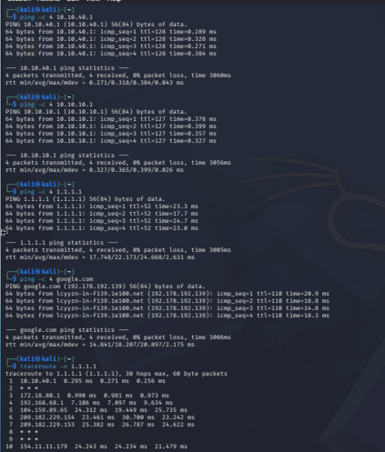

### Travelling client test
* Moved GUEST01 to VLAN 10 (Hyper-V VLAN ID 10 + IP 10.10.10.50/24). Gateway and internet both reachable, then moved back to VLAN 40.

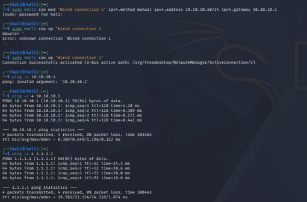

## 2026-10-28 – Guest filter (router)
* RRAS > IPv4 > General > VLAN40-Guest > Inbound Filters: drop source 10.10.40.0/24 to destination 10.10.0.0/16. Action: "Receive all packets except those that meet the criteria".
* Result: GUEST01 can no longer reach 10.10.10.1 (100% loss) but still reaches 1.1.1.1 and google.com.
* Known limitation: RRAS filters are stateless (no memory of connections). If Management connects to a Guest device, the replies to 10.10.30.x are dropped too. pfSense (Phase 4) is stateful and fixes this.

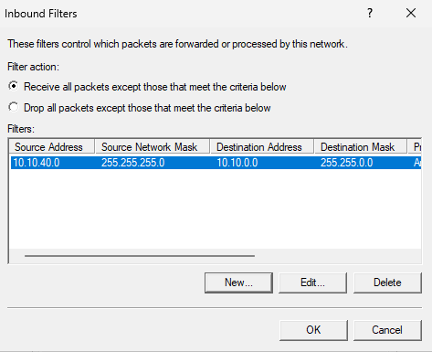
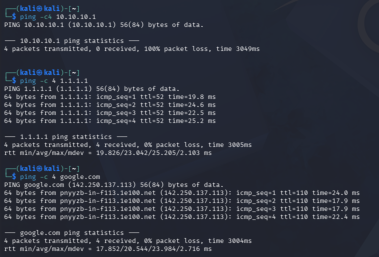

## 2026-10-30 – Host firewall on CORE-RTR01
* Turned on Remote Desktop and scoped all 3 RDP rules (TCP, UDP, shadow) to 10.10.30.0/24 only, so only the Management VLAN can RDP to the router.
* Tightened the ping rule to VLANs 10, 20 and 30. Guest can't ping the router.
* Turned on logging of dropped packets for all firewall profiles: %systemroot%\system32\LogFiles\Firewall\pfirewall.log
* Two layers of protection:
  - Router filter (RRAS): controls traffic passing THROUGH the router. Stateless.
  - Windows Defender Firewall: protects the router ITSELF. Stateful (remembers connections, so replies are allowed back automatically).

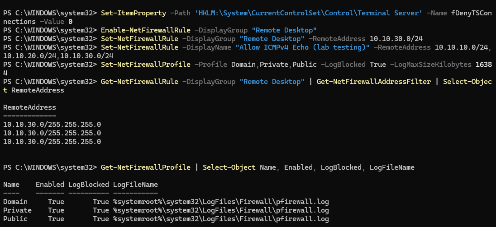

## 2026-10-30 – Policy tests
GUEST01 was moved between VLANs (Hyper-V VLAN ID + matching IP) to test each rule from the right network.

| # | From | To | Port / test | Expected (policy) | Actual | Pass? |
|---|---|---|---|---|---|---|
| A1 | VLAN 30 (10.10.30.50) | 10.10.30.1 | ping | Allowed | Reply | ✅ |
| A2 | VLAN 30 (10.10.30.50) | 10.10.30.1 | TCP 3389 (RDP) | Allowed: admin from Management | Open | ✅ |
| B1 | VLAN 20 (10.10.20.50) | 10.10.20.1 | ping | Allowed | Reply | ✅ |
| B2 | VLAN 20 (10.10.20.50) | 10.10.20.1 | TCP 3389 (RDP) | Blocked: RDP only from Management | Timed out | ✅ |
| C1 | VLAN 40 (10.10.40.50) | 10.10.10.1 | TCP 22, 80, 443, 445, 3389 | Blocked: Guest to internal | Filtered | ✅ |
| C2 | VLAN 40 (10.10.40.50) | 1.1.1.1 | ping | Allowed: Guest to internet | Reply | ✅ |
| C3 | VLAN 40 (10.10.40.50) | example.com | HTTPS | Allowed: Guest web browsing | HTTP 200 | ✅ |
| D | CORE-RTR01 firewall log | | | DROP from 10.10.20.50 to 3389 | DROP logged | ✅ |

* All results match the traffic policy (docs/traffic-policy.md).
* nc showed "inverse host lookup failed": no DNS server in the lab yet (Phase 2). Harmless. `-n` skips the lookup.

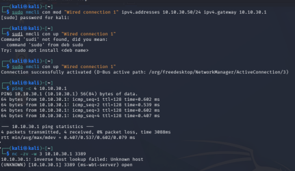
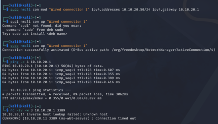
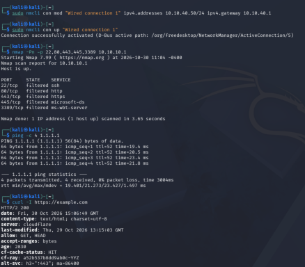
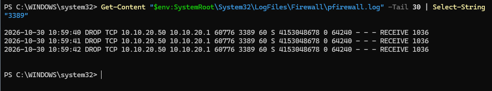

* Closed CHG0030001 as Successful on 2026-10-30, with test evidence attached.

   * CMDB: CORE-RTR01 (Windows server, virtualized by HOST01) + 4 IP network records linked to it.
   * Knowledge article: "How to add a new VLAN to the RRAS router" (KB number: KB0010001).
   * Started docs/network-design.md.

## Phase 1 summary

**What I built**
- A segmented network inside Hyper-V: one Private switch (LAB-CORE) carrying four VLANs (Servers, Workstations, Management, Guest).
- CORE-RTR01 (Windows Server 2025) routing between the VLANs with RRAS, and NAT so the whole lab shares one outside address for internet access.
- Two layers of security: a stateless RRAS filter that blocks Guest from every internal network, and stateful Windows Firewall rules on the router (RDP only from Management, ping not from Guest, drop logging on).
- GUEST01 (Kali) as a test client, moved between VLANs to prove each rule.

**Results**
- All 8 policy tests passed, and the firewall log shows the expected drops.
- Change CHG0030001 went through Network and CAB approval and was closed as Successful, with evidence attached.
- CMDB: CORE-RTR01 linked to HOST01 and the four VLAN networks. Knowledge article written for adding a new VLAN.

**What I learned**
- Connected routes: giving an adapter an IP and mask is enough for the router to know that network. Static routes are only for networks it isn't attached to.
- Stateless vs stateful: RRAS filters judge each packet alone, so return traffic has to be thought about. Windows Firewall remembers connections.
- A host firewall protects the machine itself, not traffic routed through it, so you need both layers.
- TTL drops by 1 per router hop, which is an easy way to prove traffic was routed.
- Practical lessons: match adapters by MAC (Windows numbers them randomly), keep the Hyper-V VLAN ID and the client IP in sync, and Windows blocks ping by default.

**What I'd do differently**
- Change the VLAN ID and the IP together every time. Mismatching them cost me some troubleshooting time.
- Leave more time for ServiceNow. Approvals, groups and CMDB relationships took longer than the technical work.

**Schedule**
- Planned: Oct 19 – Oct 23. Actual: Oct 18 – Oct 30 (one week late). Most of the extra time went to learning ServiceNow workflows and fitting lab sessions around work. Phase 2 dates will shift to match.
