## 2026-11-02 – Identity design and change
* Wrote the Identity section of docs/network-design.md before building anything: OU tree, naming standards, AGDLP group model and GPO inventory.
* Raised change CHG0030004 "Build Active Directory domain corp.lab.internal (Phase 2)", approved by Network group and CAB, moved to Implement.

## 2026-11-04 – Built DC01
* Gen 2, 2 vCPU, 2 GB dynamic RAM (min 1.5, max 3 GB), 60 GB disk, LAB-CORE VLAN 10.
* Windows Server 2025 Standard Evaluation (Desktop Experience).
* Static IP 10.10.10.10/24, gateway 10.10.10.1, DNS 127.0.0.1 (it will be its own DNS server once promoted).
* Checkpoint "CHG0030004-pre-promotion" taken (backout plan).

## 2026-11-04 – Promoted DC01
* Installed AD DS + DNS, created new forest corp.lab.internal (NetBIOS name CORP).
* DSRM password stored in KeePassXC only (it's the emergency repair password for AD).
* Domain admin login: CORP\Administrator.
* Checked: Get-ADDomain shows corp.lab.internal, DC01 is a Global Catalog at 10.10.10.10.
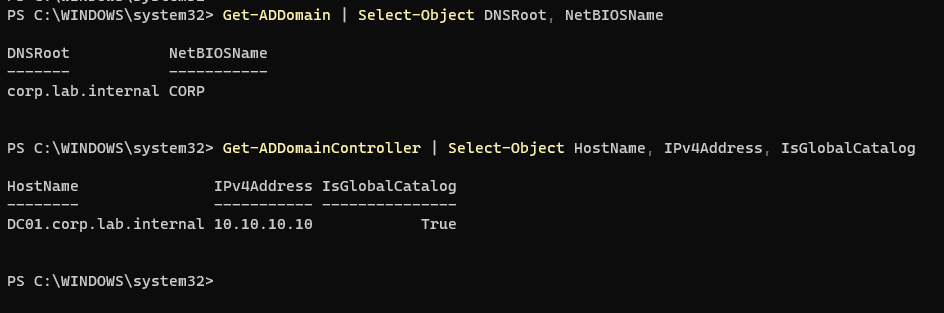

## 2026-11-04 – AD and DNS health
* dcdiag issue: "DC01 is not advertising as a time server" (Advertising + LocatorCheck failed).
  - Why it matters: Kerberos logins fail if a PC's clock is more than 5 minutes off the DC.
  - Cause: Hyper-V time sync was overriding the DC's clock, and the DC wasn't set as a reliable source.
  - Fix: disabled Hyper-V Time Synchronization for DC01 (Microsoft best practice for virtual DCs), then w32tm /config /manualpeerlist:"time.windows.com,0x8 pool.ntp.org,0x8" /syncfromflags:manual /reliable:yes /update.
* DFSREvent and SystemLog errors were from the first boot after promotion. They clear after 24 hours.

* SRV record _ldap._tcp.dc._msdcs.corp.lab.internal points to DC01 on port 389. This is how clients find a domain controller, which is why failed domain joins are usually DNS problems.
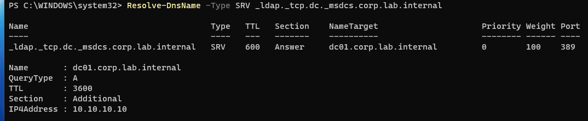
* Reverse lookup zones added for 10.10.10, 10.10.20, 10.10.30, plus a PTR record for DC01.
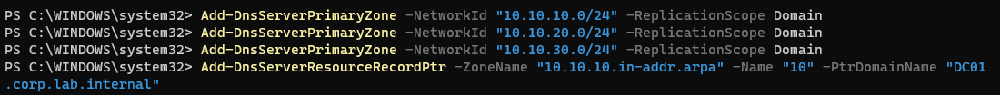
* DNS forwarders: 1.1.1.1 and 8.8.8.8 (CORE-RTR01 doesn't run DNS). To be changed to LNX-SVC01 in Phase 3.
* Tests: google.com resolves, 10.10.10.10 reverse-resolves to DC01.
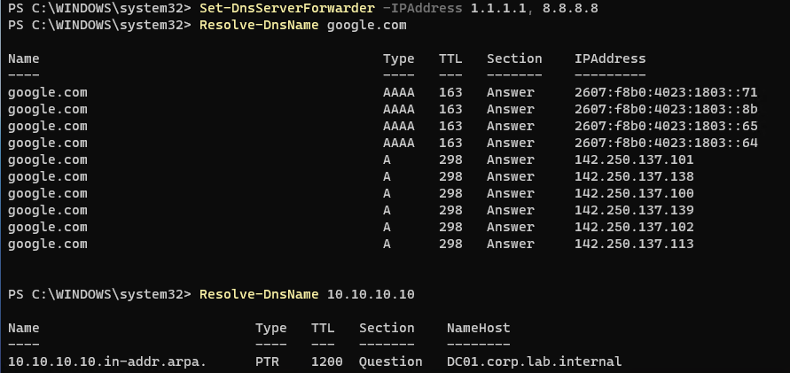

## 2026-11-04 - Build the OU tree
* Created CORP and its five children in the GUI to match the design doc (docs\netowrk-desing.md).
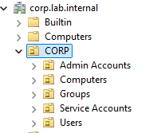
 *Created sub OU's beneath Users and Computers using PowerShell.

*Redirected new computers by default to the workstations OU using DN (Distinguished Name) that maps the path to the OU.
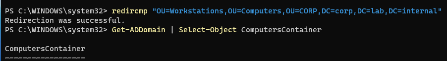
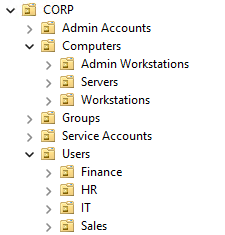

## 2026-11-05 – Users and groups (AGDLP)

### Users
* Created sarah.khan by hand in ADUC first, to see every field a new user needs.
* Created the rest with scripts/powershell/New-LabUsers.ps1, which reads scripts/powershell/users.csv (FirstName, LastName, Department) and creates each user in their department OU.
  - Logon name built as first.last (lower case), UPN first.last@corp.lab.internal.
  - Starting password typed in at runtime with Read-Host -AsSecureString, never stored in the script or the CSV.
  - Accounts enabled, and must change password at first logon.
  - Tested with -WhatIf before running for real.
* Copied the files into DC01 with Copy-VMFile (later, scripts will run from MGMT01).
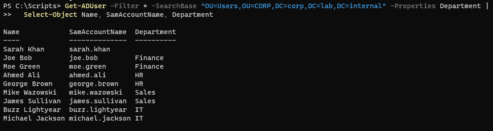

### Groups
| Group | Scope | Type | Members |
|---|---|---|---|
| GG_Finance_Staff / GG_HR_Staff / GG_Sales_Staff / GG_IT_Staff | Global | Security | Users from each department OU |
| GG_Helpdesk | Global | Security | One IT user (for Task 7) |
| DL_FinanceShare_RW | Domain Local | Security | GG_Finance_Staff |
| DL_FinanceShare_R | Domain Local | Security | (empty, ready for read-only access) |

* Security vs Distribution: only Security groups can be given permissions. Distribution groups are for email lists.
* Filled the department groups with one loop: each OU name matches its group name (Finance → GG_Finance_Staff).

### Finance share
* Folder C:\Shares\Finance, shared as \\DC01\Finance.
* Share permissions: Authenticated Users = Change, Administrators = Full. Kept simple on purpose, with real control in NTFS.
* NTFS on C:\Shares\Finance: inheritance disabled, Users removed, DL_FinanceShare_RW = Modify, DL_FinanceShare_R = Read & execute, Administrators/SYSTEM = Full.
* Share and NTFS permissions combine, and the most restrictive wins.
* Mistake fixed: first set NTFS on the parent C:\Shares instead of C:\Shares\Finance. Moved it to the Finance folder, so future department folders don't inherit Finance's permissions.

### Test (Effective Access)
| User | Expected | Result |
|---|---|---|
| Finance user | Modify | Modify |
| HR user | No access | No access |

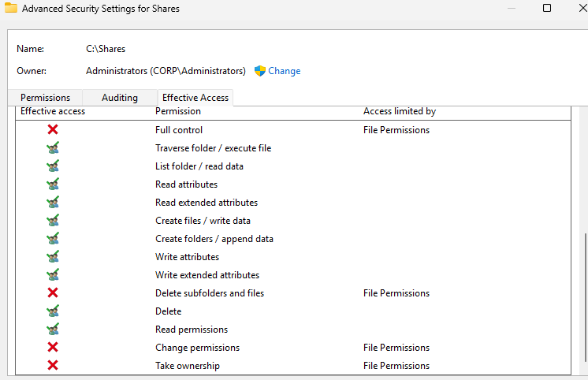

## 2026-11-05 – Built WS01 and joined it to the domain

### Build
* Gen 2, 2 vCPU, 4 GB startup RAM (dynamic, min 2 GB, max 4 GB), 64 GB disk, LAB-CORE VLAN 20.
* Windows 11 Enterprise Evaluation. Windows 11 needs a TPM, so I turned on the virtual TPM in Hyper-V (Settings > Security) before first boot.

### Network
| Setting | Value |
|---|---|
| Adapter name | VLAN20-Workstations |
| IP | 10.10.20.50/24 (temporary static until DHCP in Phase 3) |
| Gateway | 10.10.20.1 |
| DNS | 10.10.10.10 (DC01) |

* Why DNS must be DC01: clients find a domain controller by asking DNS for its SRV records (_ldap._tcp.dc._msdcs.corp.lab.internal), and those only exist in DC01's DNS. Public DNS (1.1.1.1) has never heard of corp.lab.internal, so the join would fail. That's why most failed joins are DNS problems.
* Tested before joining: ping 10.10.10.10 and Resolve-DnsName corp.lab.internal both worked.

### Domain join (GUI)
* sysdm.cpl > Change: renamed to WS01 and joined corp.lab.internal with CORP\Administrator, then restarted.
* WS01 landed in CORP > Computers > Workstations, which proves the redircmp from Task 4 works.
* First login as a domain user (CORP\sarah.khan) forced a password change. That's because the script set "must change password at next logon": the admin knew the starting password, so the user sets one only they know.

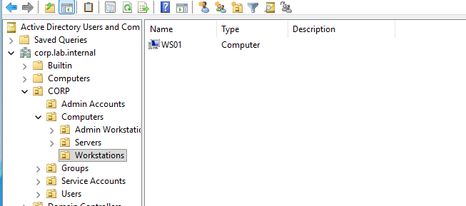

## 2026-11-05 – Built MGMT01 and joined it to the domain

### Build
* Same specs as WS01, but in LAB-CORE VLAN 30.

### Network
| Setting | Value |
|---|---|
| Adapter name | VLAN30-Management |
| IP | 10.10.30.20/24 (from IPAM sheet) |
| Gateway | 10.10.30.1 |
| DNS | 10.10.10.10 (DC01) |

### Domain join (PowerShell)
* Command: Add-Computer -DomainName corp.lab.internal -NewName MGMT01 -Credential CORP\Administrator -Restart (renames, joins and restarts in one step, with one reboot instead of two).
* Mistake along the way:
  - Put Rename-Computer and Add-Computer on one line with no ; between them, so PowerShell read the second command as a value for the first.
* Problem: the domain join succeeded, but the rename failed ("directory service is busy"). The earlier Rename-Computer had already queued a rename waiting on a restart, and it clashed with -NewName.
* Fix: restarted, logged in as .\localadmin, then [renamed with Rename-Computer -NewName MGMT01 -DomainCredential CORP\Administrator -Restart
* Lesson: restart after every rename before doing anything else, and rename a domain-joined PC with -DomainCredential so AD is updated too.
* Checked: MGMT01 appears in CORP > Computers > Workstations with no leftover DESKTOP-... object.

## 2026-11-08 – MGMT01 as the admin workstation

### Moved to Admin Workstations
* Moved MGMT01 from CORP > Computers > Workstations to CORP > Computers > Admin Workstations, so it'll get admin-PC policies instead of normal workstation ones.
* Why redircmp didn't put it there automatically: It was setup to put all computers into CORP > Computers > Workstations.

### Separate admin account
* Created adm-eesa.ali in CORP > Admin Accounts and added it to Domain Admins.
* Domain Admins = built-in group with full control of the whole domain (every user, PC, DC and GPO). It lives in the built-in Users container.
* The Admin Accounts OU only organizes accounts. Membership of the Domain Admins group is what grants the rights.
* Why a separate admin account: ...

### RSAT on MGMT01
* Logged in as CORP\adm-eesa.ali and installed RSAT: Active Directory, Group Policy Management, DNS.
* Checked: ADUC on MGMT01 shows the whole domain, and Get-ADUser works from MGMT01.
* From now on, admin work is done from MGMT01, not on DC01's console.

## 2026-11-08 – Delegated helpdesk permissions
Done from MGMT01 as adm-eesa.ali, using the Delegation of Control Wizard in ADUC.

| Delegated on | To | Rights |
|---|---|---|
| CORP > Users | GG_Helpdesk | Reset passwords and force change at next logon (common task) |
| CORP > Users | GG_Helpdesk | Read/Write lockoutTime on User objects (custom task, so they can unlock accounts) |
| CORP > Computers > Workstations | GG_Helpdesk | Create/Delete computer objects, reset password, validated write to DNS host name and SPN (so they can join PCs) |

* Delegated on CORP > Users (not the built-in Users container), so it covers every department OU, including future ones, but not Admin Accounts.
* Unlocking = clearing the lockoutTime property, which is why it's a property-specific permission.
* Why delegate to a group, not a person: ...

### Test (as the helpdesk user, using runas)
| Action | Expected | Result |
|---|---|---|
| Reset joe.bob's password (Finance) | Allowed | Succeeded |
| Reset adm-eesa.ali's password | Denied | Access is denied |

* Denied for two reasons: Admin Accounts is outside the delegated OU, and AdminSDHolder automatically protects members of privileged groups like Domain Admins.
* Real helpdesk procedure: set a temporary password AND force a change at next logon, so the user can log in but only they know the final password.

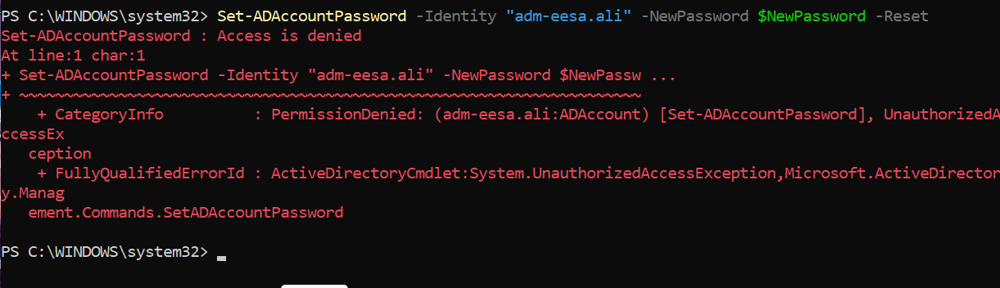

## 2026-11-09 – Incident: no routing after restart (INC0010001)
* Symptom: ADUC on MGMT01 showed "server is not operational". DC01 and MGMT01 had no internet. Login still worked thanks to cached credentials, which hid the problem.
* Troubleshooting: both VMs were running, so I checked the device they share, CORE-RTR01.
* Root cause: the RemoteAccess (RRAS) service was stopped.
* Fix: Start-Service RemoteAccess; Set-Service RemoteAccess -StartupType Automatic.
* Lesson: when several machines in different networks fail at once, check what they have in common first.

## 2026-11-09 – Service accounts, part 1: svc-web and Kerberoasting

### Classic service account: svc-web
* Created in CORP > Service Accounts using ADUC 
* For the intranet web server, LNX-WEB01, in Phase 3.
* Password: 30+ random characters from KeePassXC, stored only there.
* Settings:
  - User must change password at next logon: OFF (a service can't answer a password-change prompt, so it would fail to start)
  - User cannot change password: OFF (Password must not be changed by a user for a service account)
  - Password never expires: ON (if it expired, the web service would shut off without warning. The trade-off is that the password never changes on it's own. Risk can be reduced by making it long, rotate it manually, or use gSMA (next step)
* Description on the account: purpose, owner, link to docs/service-accounts.md.

### SPN
* Registered: setspn -S HTTP/lnx-web01.corp.lab.internal CORP\svc-web
* SPN = Service Principal Name: a label (service/host) that tells Kerberos which account runs a service, so the DC knows whose password to lock the service ticket with.

### Kerberoasting check (looking only, no attack)
* Logged in to WS01 as a normal user (sarah.khan) and ran setspn -Q */* : any domain user can list every account with an SPN.
* Computer accounts (DC01, WS01, MGMT01) have SPNs too, but their passwords are long, random and rotate every 30 days, so they're not realistic targets.
* svc-web is the only USER account with an SPN, so it's the obvious Kerberoasting target.
* I learned: Kerberoasting is a cyberattack that targets Kerberos authentication is AD and allows an attacker to steal account credentials without administrative access and without triggering account lockouts.
* Defence: long random passwords on service accounts, or better, gMSAs (240-character passwords rotated automatically).

## 2026-11-10 – Service accounts, part 2: gMSA

### KDS root key (on DC01, once per domain)
* Add-KdsRootKey -EffectiveTime ((Get-Date).AddHours(-10))
* The KDS root key is the master secret DC01 uses to calculate gMSA passwords.
* Normally it isn't usable for 10 hours, so every DC can receive a copy. Backdated by 10 hours because this lab has only one DC. In a real company: Add-KdsRootKey -EffectiveImmediately, then wait 10 hours.

### Created gmsa-uptime
* New-ADServiceAccount -Name "gmsa-uptime" -DNSHostName "gmsa-uptime.corp.lab.internal" -Path "OU=Service Accounts,OU=CORP,DC=corp,DC=lab,DC=internal" -PrincipalsAllowedToRetrieveManagedPassword 'MGMT01$'
* No password was ever set or seen. Windows generates a 240-character password and rotates it every 30 days.
* Only MGMT01 is allowed to retrieve the password from DC01. The account is useless from any other machine.
* 'MGMT01$' in single quotes: computer accounts end in $, and single quotes stop PowerShell from reading $ as a variable.
* Real companies usually allow a group of servers instead of one named computer, so hosts can be added without editing the gMSA.

### Installed and tested on MGMT01
* Install-ADServiceAccount gmsa-uptime, then Test-ADServiceAccount gmsa-uptime returned True.
* Will run the uptime monitor scheduled task in Phase 6.

### svc-web vs gmsa-uptime
| | svc-web (classic) | gmsa-uptime (gMSA) |
|---|---|---|
| Who knows the password | Admin (stored in KeePassXC) | Nobody |
| Password length | 30+ characters | 240 characters |
| Rotation | Manual (yearly, or when someone leaves) | Automatic every 30 days, no outage |
| Where it can be used | Anywhere the password is typed | Only on MGMT01 |
| Kerberoasting risk | Low with a strong password, but never zero | Practically uncrackable |

* In my own words, a gMSA is safer than svc-web because it rotates a password known to no one every 30 days. Only certain computers (or server groups) can access the gSMA.

## 2026-11-10 – Group Policy change (CHG0030006)
* Decision: one Normal change for the whole GPO baseline, with one Change Task per GPO, instead of 7 separate changes. Each GPO is still tracked, tested and closed on its own, with less admin overhead.
* Checkpoint "CHG0030006-before-GPOs" taken on DC01 (backout plan).

## 2026-11-10 – GPO 1: GPO_Domain_Password
* Created in GPMC on MGMT01, linked at the domain root (corp.lab.internal), moved to link order 1 above Default Domain Policy (lower link order wins).
* Why the domain root: DCs only read password policy for domain accounts from GPOs linked at domain level. Linked to an OU, it would only affect local accounts. (For different rules per group, use Fine-Grained Password Policies.)

| Setting | Value | Why |
|---|---|---|
| Minimum length | 14 | Length matters most for strength (NIST) |
| Complexity | Enabled | Still expected by auditors and older systems |
| Password history | 24 | Stops reuse of old passwords |
| Minimum age | 1 day | Stops users cycling through 24 changes to get an old password back |
| Maximum age | 0 (never expires) | NIST: only force a change if compromised; forced changes create weak patterns |
| Lockout threshold | 5 attempts | Stops guessing, tolerates typos |
| Lockout duration | 15 min | Unlocks itself, fewer helpdesk calls |
| Reset counter after | 15 min | Failed attempts forgotten after 15 min |

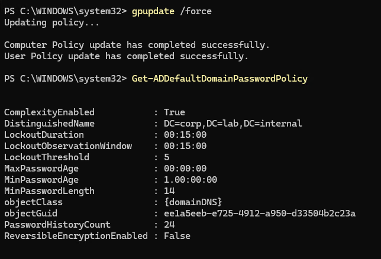

### Test
| Step | Expected | Result |
|---|---|---|
| gpupdate /force on DC01, then Get-ADDefaultDomainPasswordPolicy | Values match the table | Match |
| 5 wrong passwords for sarah.khan on WS01 | Account locked | "Account is currently locked out" |
| Search-ADAccount -LockedOut | sarah.khan listed | Listed |
| Unlock-ADAccount as buzz.lightyear (helpdesk, checked with whoami) | Allowed by Task 7 delegation | Unlocked, Search-ADAccount now empty |

* New and reset passwords (including helpdesk temporary passwords) must now be 14+ characters. Existing passwords keep working until they're next changed.
* Lockouts create Event ID 4740 on DC01, which the SIEM will alert on in Phase 7.

## 2026-11-10 – GPO 2: GPO_WS_Baseline
* Created in GPMC on MGMT01, linked to CORP > Computers > Workstations. (MGMT01 is in Admin Workstations, so it doesn't get this GPO; admin PCs get their own treatment.)

| Setting | Location | Value | Why |
|---|---|---|---|
| Logon banner title + text | Security Options > Interactive logon: Message title / text | "Authorized use only" + warning | Users can't claim they didn't know the rules; supports action against misuse |
| Block USB storage | Admin Templates > System > Removable Storage Access | All classes: Deny all access | Stops data leaving on USB sticks and malware coming in |
| Firewall | Windows Defender Firewall > Properties (Domain, Private, Public) | On, inbound Block, outbound Allow | Default deny for incoming connections |
| Firewall logging | Same, Logging > Customize | Log dropped packets, 16 MB, pfirewall.log | Evidence for troubleshooting and the SIEM (Phase 7) |
| Inbound rule | Inbound Rules | Allow ICMPv4 from 10.10.30.0/24 only | Only IT (Management VLAN) can ping workstations |

* Workstation-to-workstation traffic (traffic policy: "Nothing") is already covered by inbound Block, so no extra rule was needed.

### Verified on WS01
* gpupdate /force, then gpresult /r /scope computer: GPO_WS_Baseline listed under Applied Group Policy Objects.
* USB: Deny_All = 1 in HKLM\SOFTWARE\Policies\Microsoft\Windows\RemovableStorageDevices.
* Firewall: Get-NetFirewallProfile -PolicyStore ActiveStore shows Enabled and LogBlocked True on all profiles.
* Rule: "Allow ping from Management VLAN" active.
* Logon banner shows before login.

### Not tested
* Ping from MGMT01 (expected: allowed) and from DC01 (expected: blocked). The 16 GB host is too slow running four VMs at once. The rule's presence and scope were verified on WS01 instead. To re-test later with lighter VMs, use Kali on VLAN 30 as the Management client.

